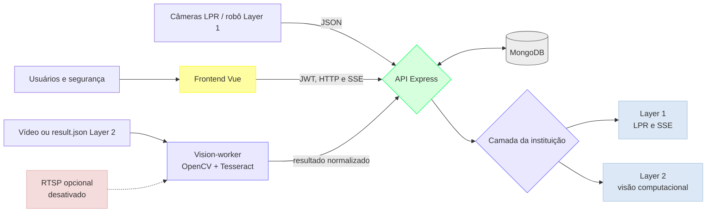
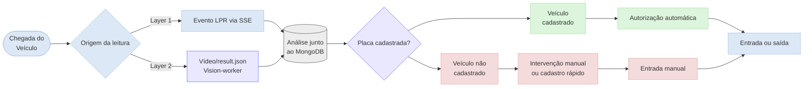
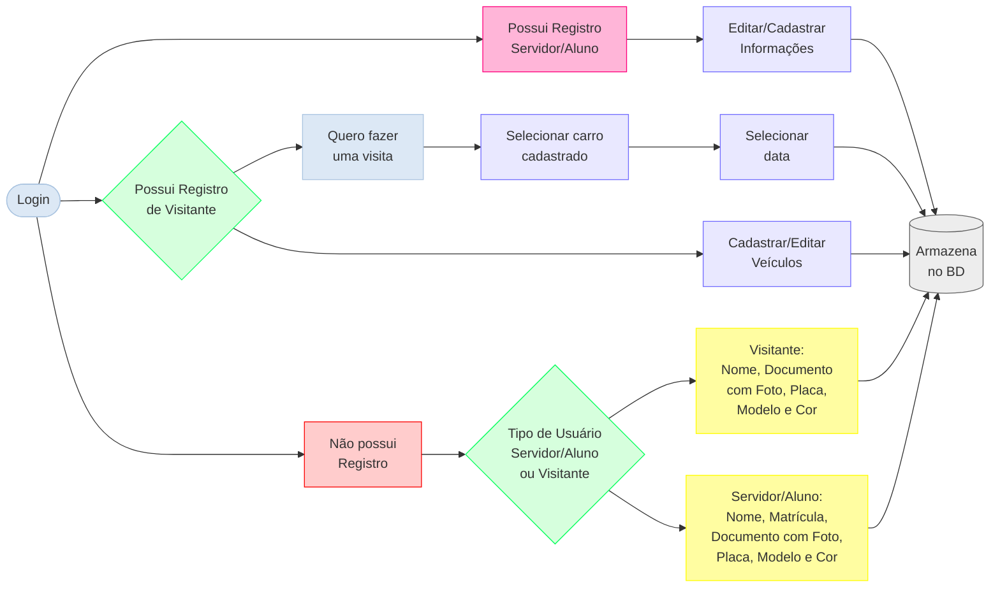
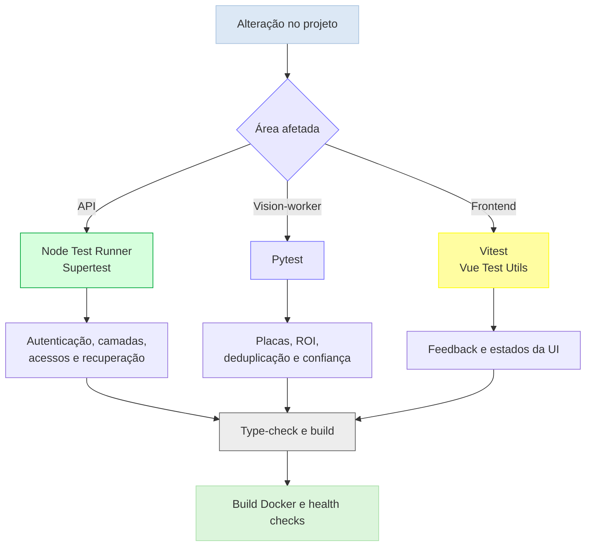
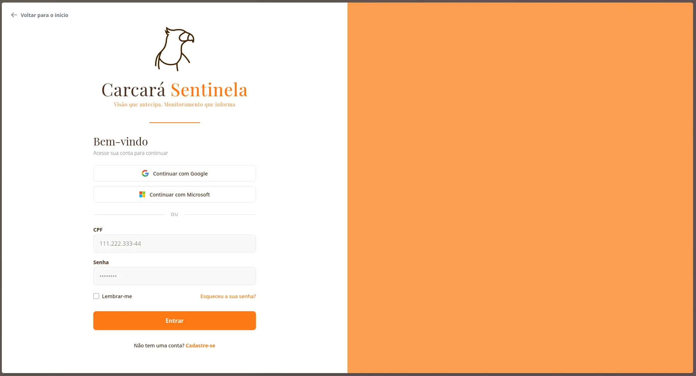
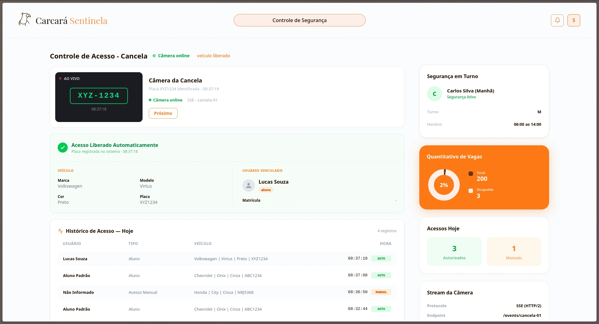
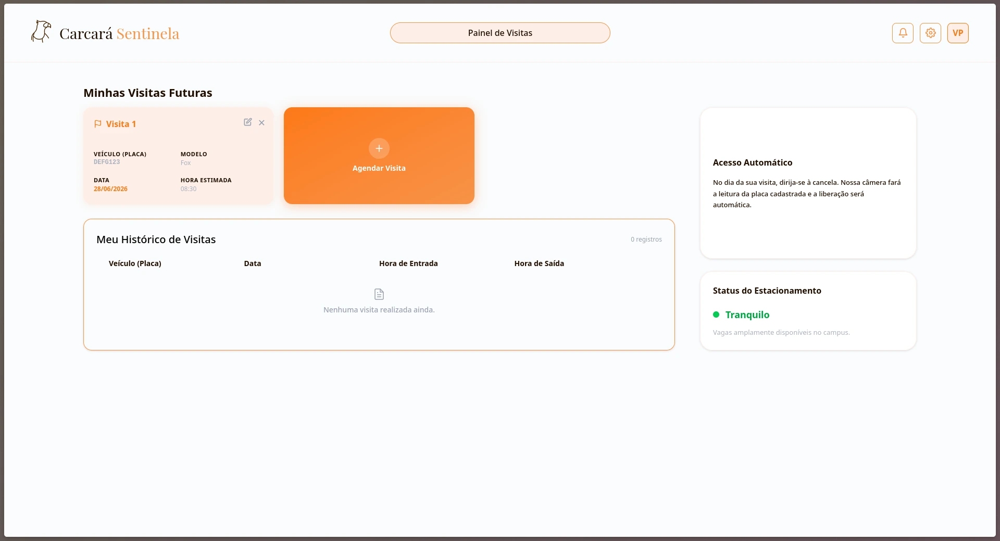

 
 

 

### Sistema de Autenticação e Controle de Acesso de Veículos em Instituições Federais de Ensino

---

## Links Uteis

* [Wiki do Projeto](https://github.com/alberthydev/carcara-sentinela/wiki)
* [Documentação API](https://portal.swaggerhub.com/apis/alberthydev/carcara-sentinela-api/1.0.0?source=catalog#/Auth/post_login)

## Problema

Institutos Federais de Ensino são ambientes com grande e constante circulação de pessoas, estudantes, servidores e visitantes, o que os torna vulneráveis quando não há monitoramento adequado. Em instituições que atendem alunos menores de idade, essa vulnerabilidade é ainda mais crítica.

O cenário brasileiro de insegurança agrava esse quadro: ambientes educacionais não estão imunes à violência urbana, e muitas instituições não dispõem de recursos suficientes para garantir a proteção necessária. O modelo tradicional de segurança, baseado em intervenções manuais na guarita, é suscetível a falhas humanas, não gera registros confiáveis e não oferece suporte à tomada de decisão em tempo real.

Sabe-se que conhecer o fluxo de acesso ao ambiente estudantil é primordial para uma cultura de segurança preventiva, e é exatamente essa lacuna que o projeto busca endereçar.

---

## Proposta

O **Carcará Sentinela** propõe um ecossistema de software integrado às câmeras LPR já existentes no campus, capaz de identificar automaticamente veículos cadastrados, alertar sobre acessos não reconhecidos e fornecer um painel de controle em tempo real para a equipe de segurança.

A solução é desenvolvida em **código aberto**, focada no cadastramento de servidores, alunos e visitantes, e gerenciada pelo próprio setor responsável da instituição. Indo além de uma barreira física, o sistema atua na **prevenção de incidentes** e no **controle de acessos indevidos**, gerando registros ágeis que promovem transparência para gestores, alunos e visitantes, sem restringir o caráter público da instituição.

---

## Objetivos

- Monitorar o fluxo de acesso veicular no campus em tempo real
- Automatizar a identificação de veículos cadastrados via lógica de **Whitelist**
- Fornecer um painel de controle para a equipe de segurança
- Reduzir a dependência de intervenções manuais na guarita
- Garantir transparência e rastreabilidade dos registros de acesso

---

## Stack Tecnológica

| Camada               | Tecnologia                              |
| -------------------- | --------------------------------------- |
| Linguagem base       | JavaScript / TypeScript                 |
| Servidor / API       | Node.js + Express.js                    |
| Frontend Web         | Vue.js                                  |
| Banco de Dados       | MongoDB                                 |
| Processamento Layer 2 | Python + OpenCV + Tesseract |
| Aquisição de dados | Câmeras LPR, vídeos e RTSP opcional |

---

## Arquitetura do Sistema

## Camadas de recursos

Cada instituição possui uma camada configurada pela API:

- **Layer 1**: mantém o fluxo atual de câmeras LPR e os endpoints de stream/evento.
- **Layer 2**: representa instituições sem LPR. Os recursos exclusivos de LPR são bloqueados e a futura aquisição por visão computacional será habilitada nesta camada.

A camada é persistida em `Configuracao.camada` e pode ser alterada pelo endpoint autenticado de configuração. A ausência do campo em instalações existentes mantém o comportamento compatível com a Layer 1.

## Operação local

Use `docker compose -f docker-compose.dev.yml up` para desenvolvimento e `docker compose up --build` para produção local. A API expõe `/health` (processo) e `/health/ready` (processo + MongoDB); o vision-worker expõe `/health`.

Na **Layer 1**, o painel de segurança mantém o SSE e o robô de placas pode ser iniciado ou pausado apenas pelas ferramentas Dev. O status diferencia robô ativo, SSE conectado e câmera offline. Na **Layer 2**, o SSE e o robô não são abertos: envie um vídeo ou `result.json` pelo painel Dev. O worker retorna leituras consolidadas com confiança e o painel registra o resultado na sessão, permitindo limpar apenas a leitura atual. A integração RTSP possui toggle próprio e fica desativada por padrão.

## Estratégia de testes e visão computacional

O projeto combina testes de contrato HTTP/caixa-preta, testes unitários do vision-worker e testes de UI. A API usa Node Test Runner, `tsx` e Supertest; o worker usa Pytest; a UI usa Vitest e Vue Test Utils. Todos os fluxos devem passar por type-check e build.

Para a Layer 2, FFmpeg é adequado para captura/decodificação e OpenCV para seleção de frames, correção de perspectiva e melhoria da imagem. O Tesseract pode ser usado como OCR após essa etapa, mas não é um detector de placas por si só e tende a exigir calibração por câmera. A implementação deve ficar isolada em um worker de processamento, enviar eventos normalizados para a API e incluir confiança, frame de origem e revisão humana; antes da adoção, deve ser comparada com um detector especializado de placas (por exemplo, YOLO + OCR) em amostras reais do campus.

## Fluxo de Acesso Veicular

## Fluxo do Usuário

---

## Fluxo de testes

## Documentação da apresentação

O documento [`apresentacao.md`](./apresentacao.md) reúne os objetivos, funcionalidades implementadas, fluxos atualizados, roteiro de demonstração, testes e limitações conhecidas.

## Equipe

| Nome             | Papel                |
| ---------------- | -------------------- |
| Hygor Marques    | Aluno pesquisador    |
| Isadora Cozendey | Aluna pesquisadora   |
| Tiago Heineck    | Professor orientador |
| Tiago Gonçalves | Professor orientador |
| Fabricio Bizzoto | Professor orientador |

> Instituto Federal Catarinense — Campus Videira/SC
> Curso Bacharelado em Ciência da Computação

---

## Cronograma

| Atividade                                                           | Fev | Mar | Abr | Mai | Jun |
| ------------------------------------------------------------------- | :-: | :-: | :-: | :-: | :-: |
| Definição do tema do projeto                                      | ✅ |    |    |    |    |
| Definição de requisitos e estudo do padrão JSON das câmeras LPR |    | ✅ |    |    |    |
| Levantamento de referências                                        |    | ✅ |    |    |    |
| Escolha das tecnologias                                             |    | ✅ |    |    |    |
| Planejamento dos procedimentos                                      |    | ✅ |    |    |    |
| Modelagem do Banco de Dados e Setup do Ambiente                     |    |    | ✅ |    |    |
| Desenvolvimento da API de Ingestão                                 |    |    | ✅ | ✅ |    |
| Desenvolvimento do App de Cadastro                                  |    |    | ✅ | ✅ |    |
| Desenvolvimento do Dashboard do Segurança                          |    |    |    | ✅ | ✅ |
| Testes de Integração e Homologação na Guarita                   |    |    |    |    | ✅ |
| Finalização do Relatório Técnico e Apresentação do PI com MVP |    |    |    |    | ✅ |

---

### Imagens do Sistema

#### Login

#### Segurança

#### Visitante

---

## Referências

- CASTRO, J. P. *Segurança universitária: um desafio em tempos de insegurança.* Integração Multidisciplinar, Cap. 5. DOI: 10.63330/aurumpub.006-005
- STELZER, J. et al. *Segurança nas instituições federais de ensino: estudo de caso do IFSC Araranguá.* XVI CIGU, Arequipa, 2016.
- FERREIRA JUNIOR, A. et al. *Avanços e desafios na segurança universitária: um estudo na UFV.* Contribuciones a Las Ciencias Sociales, v. 18, n. 4, 2025.
- ANDRADE FILHO, O. E. *Violência urbana: uma análise do fenômeno na UFPB (Campus I).* Dissertação de Mestrado, UFPB, 2021.

---

Desenvolvido com 💚 no **IFC Videira/SC** — 2026

