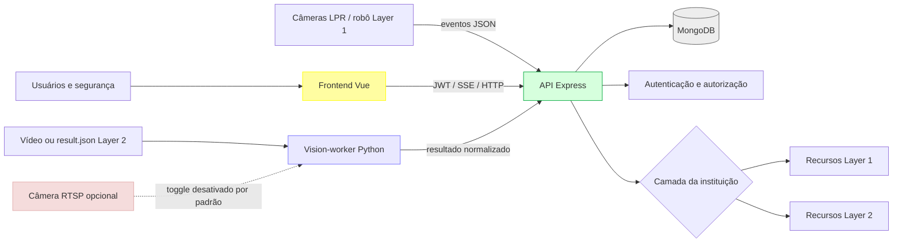
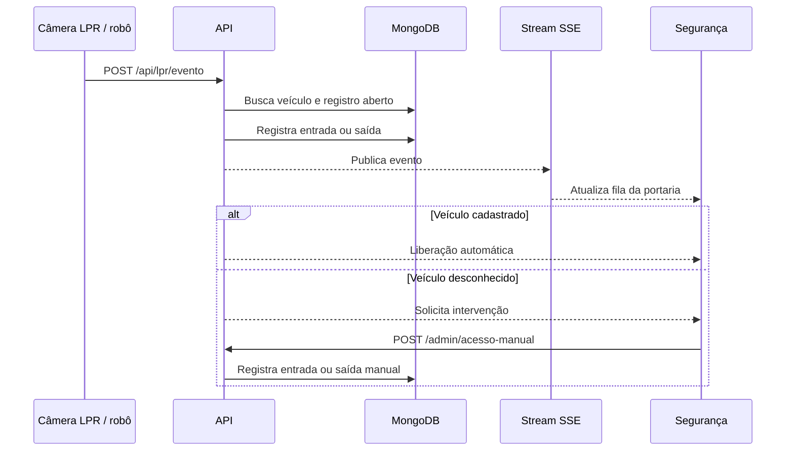
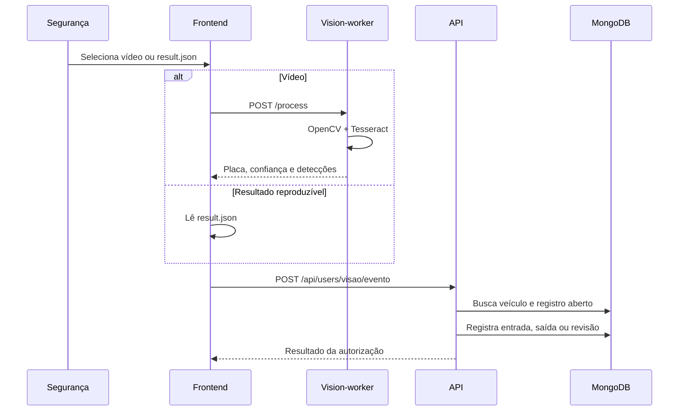
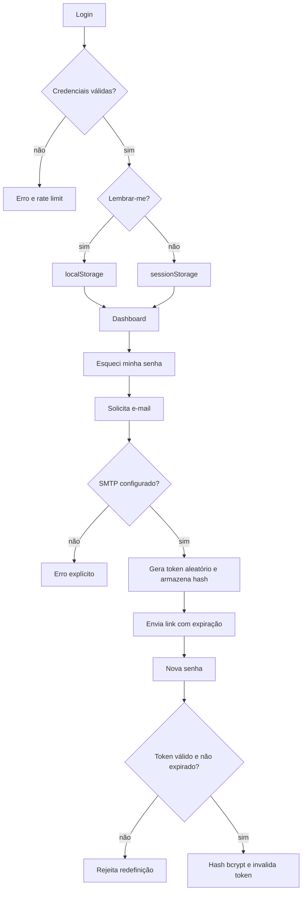
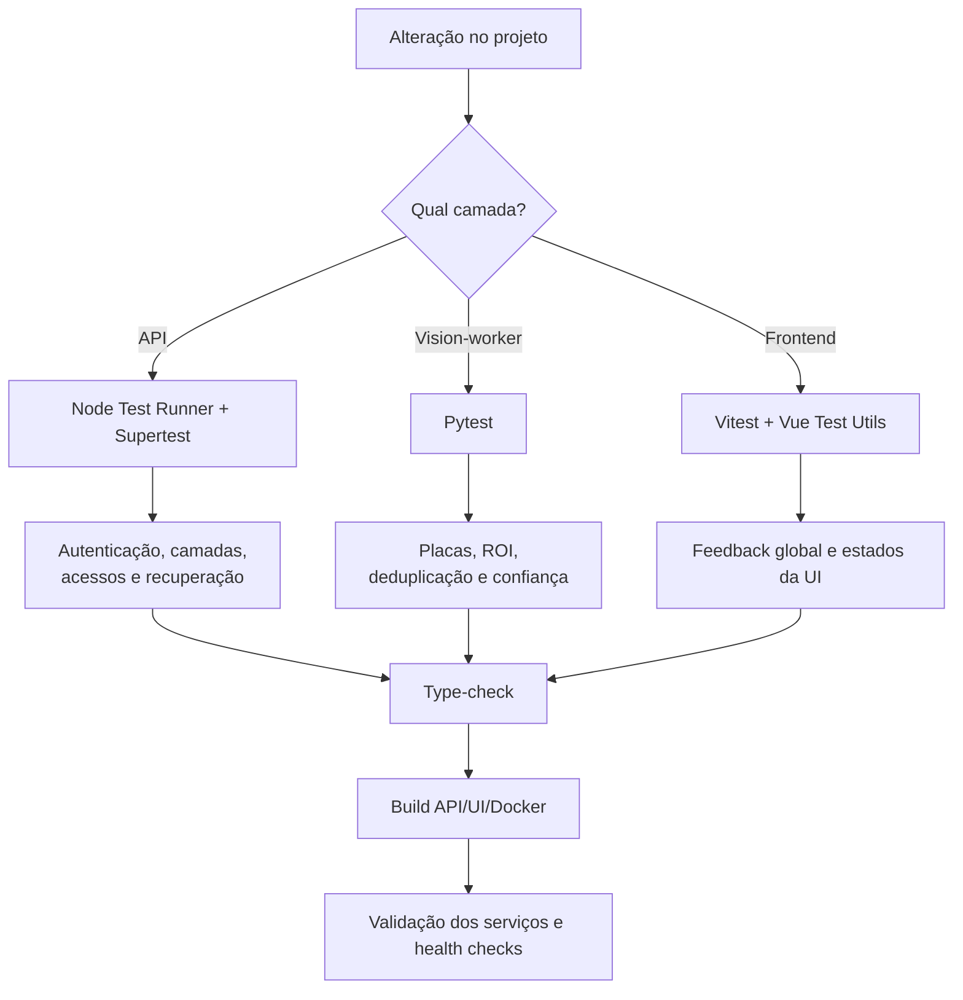

# Carcará Sentinela — apresentação do projeto

## 1. Visão geral

O Carcará Sentinela é um sistema de controle de acesso veicular para instituições de ensino. A solução registra entradas e saídas, identifica veículos cadastrados, apoia a segurança em intervenções manuais e fornece informações de ocupação do estacionamento em tempo real.

O sistema foi preparado para dois cenários:

- **Layer 1:** instituição que já possui câmeras com LPR.
- **Layer 2:** instituição que não possui LPR e utiliza visão computacional para processar vídeos.

Essa separação permite liberar apenas os recursos compatíveis com cada infraestrutura, sem duplicar o sistema para cada tipo de instituição.

## 2. Objetivos

- Monitorar o fluxo de veículos no campus.
- Automatizar a identificação de veículos cadastrados.
- Reduzir a dependência de conferências manuais.
- Registrar entradas, saídas e liberações manuais.
- Apoiar a segurança com histórico, fila de eventos e intervenção humana.
- Exibir a ocupação atual do estacionamento.
- Permitir evolução para instituições sem câmeras LPR.
- Manter autenticação, autorização por perfil e controle por camada.
- Fornecer testes automatizados para os contratos mais importantes.

## 3. O que foi implementado

### 3.1 Arquitetura e camadas

- Configuração persistida da instituição em `Configuracao.camada`.
- Usuários desenvolvedores podem alternar a camada.
- Recursos Layer 1 são bloqueados para instituições Layer 2.
- Recursos Layer 2 são bloqueados para instituições Layer 1.
- A ausência de configuração de camada mantém compatibilidade com Layer 1.

### 3.2 Layer 1 — câmeras LPR

- Recepção de eventos de placas pela API.
- Stream SSE para entrega de eventos à tela de segurança.
- Autorização automática de veículos cadastrados.
- Intervenção manual para placas desconhecidas.
- Cadastro rápido de veículo na portaria.
- Robô de demonstração que pode ser iniciado e pausado pelas ferramentas Dev.
- Separação visual entre robô ativo, SSE conectado e câmera offline.
- Reconexão SSE com backoff.

### 3.3 Layer 2 — visão computacional

- Vision-worker isolado em uma imagem Docker própria.
- Processamento de vídeo com OpenCV.
- OCR com Tesseract.
- Normalização de placas brasileiras.
- Deduplicação de leituras no mesmo frame.
- Consolidação de várias leituras e cálculo de confiança.
- Uso de `result.json` para demonstrações reproduzíveis.
- Envio do resultado normalizado para a API.
- Autorização automática ou encaminhamento para revisão manual.

O fluxo atual processa vídeos enviados. O suporte RTSP foi preparado por feature toggle e permanece desativado por padrão.

### 3.4 Feature toggle RTSP

O vision-worker possui:

- `VISION_RTSP_ENABLED=false`: controla o recurso no worker.
- `VITE_RTSP_ENABLED=false`: controla a opção exibida na interface.
- `GET /rtsp/status`: informa se o recurso está habilitado.
- `POST /rtsp/connect`: valida a URL, abre a câmera e tenta ler o primeiro frame.

Para ativar em um ambiente autorizado:

```env
VISION_RTSP_ENABLED=true
VITE_RTSP_ENABLED=true
```

### 3.5 Autenticação e segurança

- Login por CPF e senha.
- Login Google.
- Sessão persistente com “lembrar-me”.
- Sessão temporária sem “lembrar-me”.
- Logout limpando os dois storages.
- Recuperação de senha por e-mail.
- Token de recuperação aleatório, armazenado somente como hash.
- Expiração do token em 30 minutos.
- Invalidação do token após uso.
- Rate limit em autenticação e recuperação.
- Senhas protegidas com bcrypt.
- CORS restrito por `CORS_ORIGIN`.
- Middlewares de autenticação, perfil, propriedade e camada.

### 3.6 Operação da portaria

- Registro de acesso automático.
- Registro de acesso manual.
- Entrada e saída identificadas pela existência de registro aberto.
- Contador de vagas baseado em placas distintas com entrada aberta.
- Atualização do contador sem cache após novas liberações.
- Serialização das atualizações para evitar valores atrasados.
- Histórico de acessos do dia.
- Contadores de acessos automáticos e manuais.

### 3.7 Interface

- Login e cadastro redesenhados.
- Transição entre login e cadastro com View Transitions API.
- Campos com contraste e estado desabilitado consistente.
- Feedback global por notificações.
- Estados de carregamento e prevenção de duplo envio em fluxos principais.
- Ferramentas Dev restritas ao usuário desenvolvedor.
- Recursos de demonstração condicionados à camada real.

## 4. Arquitetura atual



## 5. Fluxo Layer 1



## 6. Fluxo Layer 2



## 7. Fluxo de autenticação e recuperação



## 8. Fluxo de testes



Validações atuais:

- API: 26 testes passando.
- Vision-worker: 13 testes passando.
- UI: 2 testes Vitest passando.
- Type-check da API e UI.
- Build das imagens Docker da API, UI e vision-worker.

## 9. URLs

| Serviço | URL |
|---|---|
| Aplicação | `http://localhost` |
| API | `http://localhost:3000` |
| Swagger | `http://localhost:3000/docs` |
| Vision-worker | `http://localhost:8000/health` |

## 10. Limites atuais e próximos passos

- O RTSP está preparado, mas desativado por padrão; a conexão atual valida a abertura e o primeiro frame.
- O processamento contínuo de stream RTSP ainda pode ser evoluído.
- O envio SMTP real depende de configuração externa.
- A UI ainda pode receber mais testes E2E de navegador.
- O detector de placas pode ser comparado futuramente com modelos especializados.

## 11. Preparação futura para produção com redes neurais

### 11.1 Motivação

O Tesseract atende ao objetivo de demonstrar o conceito da Layer 2, mas não é a melhor escolha para uma operação contínua em ambiente externo. Ele depende de uma imagem já bem recortada, sofre com desfoque, perspectiva, iluminação e caracteres pequenos, além de analisar cada imagem de forma isolada.

Para produção, a evolução recomendada é substituir o fluxo:

```text
OpenCV → recorte heurístico → Tesseract
```

por um pipeline treinado e temporalmente estável:

```text
YOLO para detecção → tracker → recorte da placa
→ OCR neural → validação do padrão brasileiro
→ votação temporal → evento para a API
```

### 11.2 Avaliação comparativa dos artigos

| Artigo | Estratégia | Resultado relevante | Aplicação ao Carcará |
|---|---|---|---|
| **Artigo 1 — YOLOv8 + SORT + EasyOCR + interpolação temporal** | Detecta veículos e placas, acompanha cada veículo entre frames e recompõe lacunas de rastreamento | Recuperou 2.289 posições, aumentando os registros espaciais em 101,9%; confiança OCR média de 0,414 | Aproveitar tracking, associação temporal e controle de leituras perdidas; não copiar o OCR nem a regra de placas britânicas |
| **Artigo 2 — USP/Brasil, YOLO + Visual Rhythm + EasyOCR** | Resume o vídeo em uma representação espaço-temporal e escolhe um frame por veículo | CER de aproximadamente 15,76% em experimento preliminar com placas brasileiras | É o mais aderente ao contexto nacional e pode reduzir custo de análise, mas precisa de mais validação antes de ser considerado solução de produção |
| **Artigo 3 — pipeline multi-tarefa com validação temporal** | Compartilha uma GPU entre detectores e converte previsões de frames em eventos confirmados | Placas: exact-match de 66,7% para 81,8% com votação temporal; latência inferior a 100 ms no sistema avaliado | Aproveitar a arquitetura de confirmação temporal, votação ponderada e processamento paralelo; os números não são diretamente comparáveis ao cenário brasileiro |

O **Artigo 2 é a principal referência de domínio** porque usa o formato brasileiro e considera o problema de escolher uma representação eficiente do vídeo. Entretanto, ele não apresenta a melhor métrica absoluta entre os três documentos: seu experimento é preliminar e reporta CER, enquanto o Artigo 3 reporta exact-match em outro conjunto de dados e contexto. O Artigo 3 apresenta a melhor evidência de operação em tempo real, mas utiliza um sistema multi-tarefa com GPU e não foi validado especificamente para o campus brasileiro. Portanto, os resultados devem ser apresentados como complementares, não como um ranking direto.

### 11.3 Arquitetura neural proposta

```mermaid
flowchart LR
    C[Câmera IP / RTSP] --> S[Captura e amostragem]
    S --> D[Detector YOLO\nveículo e placa]
    D --> T[Tracker\nSORT, ByteTrack ou similar]
    T --> Q[Controle de qualidade\nfoco, tamanho e perspectiva]
    Q --> O[OCR neural\nEasyOCR, PaddleOCR ou modelo treinado]
    O --> B[Validação do padrão\nbrasileiro]
    B --> V[Votação temporal\nconfiança e deduplicação]
    V --> E[Evento normalizado]
    E --> API[API Carcará Sentinela]
    API --> DB[(MongoDB)]
    API --> UI[Painel de segurança]

    style C fill:#dce8f5,stroke:#aac4e0
    style D fill:#E9E8FF,stroke:#716BFF
    style T fill:#E9E8FF,stroke:#716BFF
    style O fill:#FFFDA1,stroke:#FFFD00
    style V fill:#D6FFDD,stroke:#00A83B
    style API fill:#D6FFDD,stroke:#00A83B
    style DB fill:#EDEDED,stroke:#5E5E5E
```



### 11.4 Estratégia de desenvolvimento

1. Coletar vídeos representativos da instituição, com autorização e proteção dos dados.
2. Medir resolução da placa, iluminação, ângulo, velocidade e oclusão.
3. Criar um conjunto anotado com placas brasileiras, veículos e condições reais.
4. Treinar ou ajustar o detector de placa para as câmeras do local.
5. Comparar OCR neural com Tesseract no mesmo conjunto de teste.
6. Adicionar tracking e votação temporal para não decidir por uma única leitura.
7. Definir limiares separados para liberação automática e revisão humana.
8. Testar falsos positivos, placas desconhecidas, motos, chuva, noite e veículos em sentidos diferentes.
9. Fazer piloto em uma câmera antes de ampliar para o campus.
10. Medir latência, taxa de leitura correta, consumo de GPU e estabilidade por câmera.

O sistema deve conservar a intervenção humana quando a confiança for insuficiente. Uma leitura neural não deve liberar um veículo somente porque produziu algum texto; ela precisa atender à qualidade mínima, ao padrão da placa e à consistência entre frames.

## 12. Requisitos mínimos para implantação

Os requisitos abaixo são uma referência inicial para orçamento. A especificação final deve ser confirmada após teste com vídeos reais, quantidade de câmeras e resolução escolhida.

| Item | Demonstração / piloto | Produção — 1 câmera | Produção — 2 a 4 câmeras |
|---|---|---|---|
| Processador | 4 núcleos | 8 núcleos | 8 a 16 núcleos |
| Memória RAM | 8 GB | 16 GB | 32 GB |
| GPU | Opcional | NVIDIA com 6 GB de VRAM ou equivalente | NVIDIA com 8 a 12 GB de VRAM ou mais |
| Armazenamento | SSD de 20 GB livres | SSD de 100 GB livres | SSD de 250 GB ou mais |
| Sistema | Linux 64 bits ou Windows com Docker | Linux 64 bits recomendado | Linux 64 bits recomendado |
| Câmera | Vídeo 720p/1080p para teste | IP 1080p, posição fixa e iluminação adequada | IP 1080p ou superior, uma entrada por stream |
| Rede | 100 Mbps | Rede local estável e latência baixa | Switch e uplink dimensionados para todos os streams |
| Energia | Fonte convencional | Nobreak recomendado | Nobreak e proteção elétrica recomendados |
| Software | Docker, API, MongoDB e worker | Docker, worker neural e monitoramento | Worker com filas, monitoramento e estratégia de recuperação |

O requisito mais importante não é somente a resolução da câmera: a placa precisa ocupar uma área suficiente da imagem, estar relativamente frontal e possuir iluminação que permita ao detector e ao OCR distinguirem os caracteres. Uma câmera inadequada não é compensada apenas por uma GPU maior.

## 13. Modelo de serviço e orçamento

Os tiers comerciais abaixo são uma forma de estruturar uma proposta; os valores devem ser definidos após vistoria técnica.

| Pacote | Entrega | Perfil |
|---|---|---|
| **Essencial — Layer 1** | Integração com câmeras LPR existentes, API, painel, cadastro, histórico e treinamento inicial | Instituição que já possui LPR compatível |
| **Visão — Layer 2** | Computador dedicado, worker neural, integração com câmeras IP/RTSP, calibração por câmera e revisão humana | Instituição sem LPR que precisa reaproveitar câmeras IP |
| **Visão Plus** | Tudo do Layer 2, otimização do modelo com dados locais, múltiplos streams, monitoramento, backups e suporte com SLA | Campus com maior volume ou necessidade operacional contínua |

O orçamento deve considerar:

- quantidade e modelo das câmeras;
- quantidade de entradas e streams simultâneos;
- resolução, FPS e retenção de vídeos;
- computador dedicado e eventual GPU;
- instalação, configuração de rede e nobreak;
- coleta e anotação de dados locais;
- calibração de região de interesse e sentido de entrada/saída;
- treinamento dos operadores;
- suporte remoto ou presencial;
- manutenção, atualização do modelo e acompanhamento de métricas.

Uma implantação responsável deve separar **software**, **infraestrutura** e **serviço especializado**. O software pode ser aberto e modular, mas a adaptação ao campus exige vistoria, ajuste de câmeras, treinamento com dados locais e acompanhamento após a entrada em operação.

